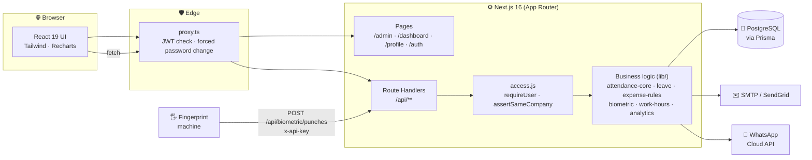
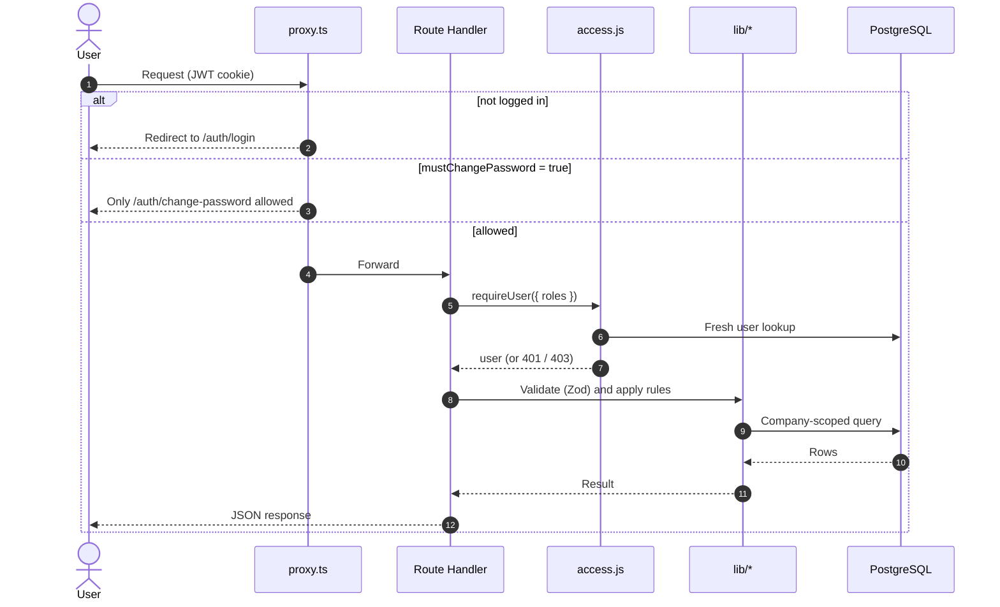
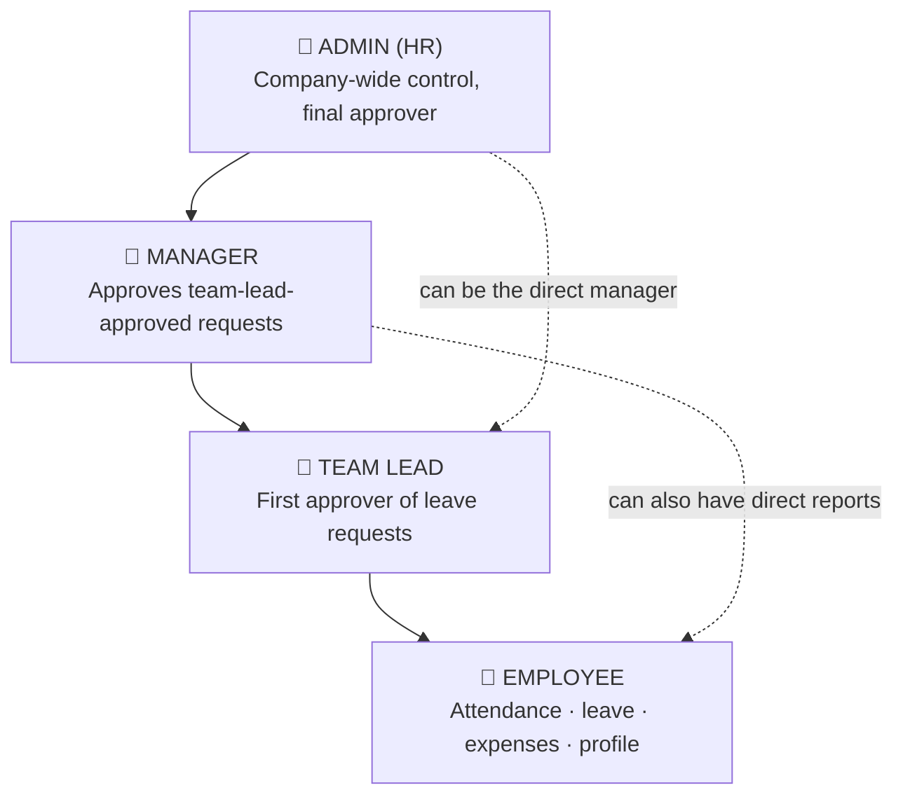
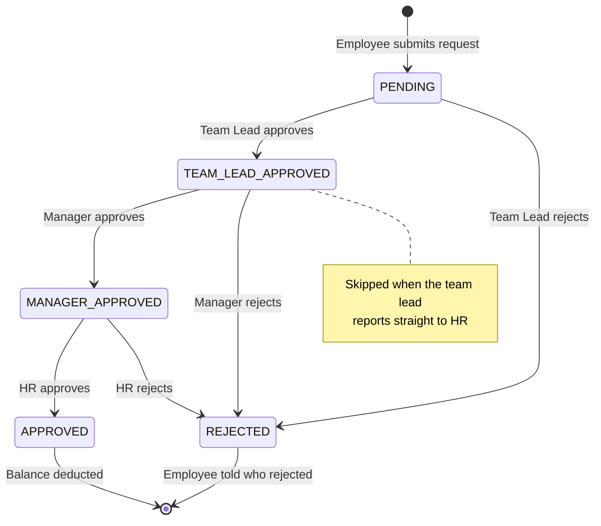
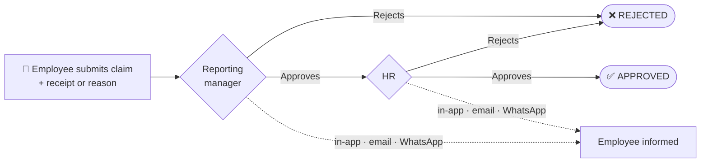
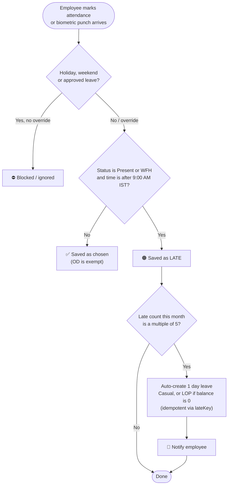
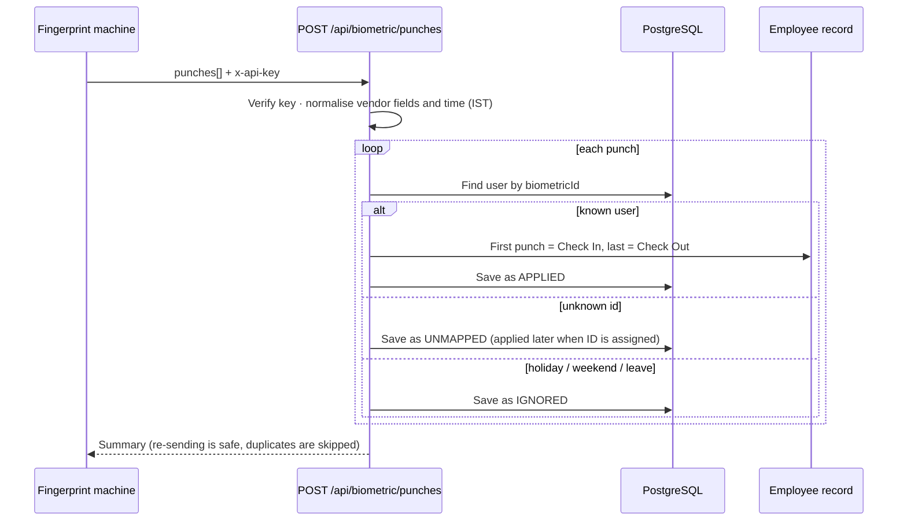
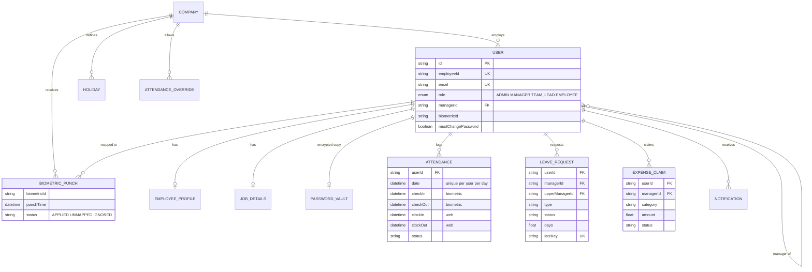
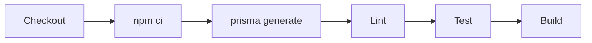

<div align="center">


# Keystone HRMS

### A role-based Human Resource Management System with biometric attendance, multi-level approvals and automatic HR rules

[](https://nextjs.org/)
[](https://react.dev/)
[](https://www.prisma.io/)
[](https://www.postgresql.org/)
[-9333EA)](https://next-auth.js.org/)
[](https://tailwindcss.com/)
[](#-testing)
[](#-cicd)
[](LICENSE)

[Features](#-features) · [Architecture](#-architecture) · [Workflows](#-workflows) · [Data Model](#-data-model) · [Getting Started](#-getting-started) · [API](#-api-reference) · [Testing](#-testing)

</div>

---

## 📌 Overview

**Keystone HRMS** is a full-stack HR platform built on the **Next.js App Router**. It covers the daily life of a company: who is in the office, who is on leave, who needs an approval, and who claimed which expense, with the company rules (office timing, late marks, leave quotas, approval chains) enforced **on the server**, not just in the UI.

It supports **four roles** (HR/Admin, Manager, Team Lead, Employee), a **fingerprint-machine API**, **email approve/reject links**, **WhatsApp alerts**, in-app notifications, analytics dashboards and Excel/PDF exports.

> All date logic is pinned to **India Standard Time (Asia/Kolkata)**, so "9:00 AM late" means 9:00 AM in India no matter where the server runs.

---

## ✨ Features

<table>
<tr>
<td width="50%" valign="top">

### 🕒 Attendance
- Interactive **monthly calendar** with a colour per status (Present, Absent, Late, WFH, OD, holiday, weekend)
- **Clock In / Clock Out** self-service from the dashboard
- **Check In / Check Out** from the **fingerprint machine** (first punch = in, last punch = out)
- Marking Present/WFH after **9:00 AM becomes Late** automatically
- **Every 5th late mark in a month = 1 day of leave** (auto-deducted, idempotent, falls back to LOP)
- Holiday/weekend marking blocked unless HR adds an override

</td>
<td width="50%" valign="top">

### 🌴 Leave, WFH and On-Duty
- Categories: Sick, Casual, Earned, LOP, Compensate, Restricted Holiday, plus **WFH** and **OD** requests
- **Yearly quotas** (Sick 8, Casual 8) with live balance
- Working-day calculation (weekends and holidays excluded), overlap detection, **mandatory reason**
- **Approval chain:** Team Lead → Manager → HR
- **One-click Approve/Reject from email** using single-use, expiring tokens
- Tells the employee *who* approved or rejected

</td>
</tr>
<tr>
<td valign="top">

### 💸 Expense Claims (On-Duty)
- Categories: Travel, Accommodation, Food, Local conveyance, Office supplies, Client entertainment
- Receipt upload, or a written reason when there is no bill
- **Manager → HR** two-step approval
- Alerts via in-app, email and **WhatsApp Business Cloud API**

</td>
<td valign="top">

### 👥 People & Admin
- Create employees singly or **bulk upload**
- Auto-generated employee IDs, forced password change on first login
- Reporting line (Team Lead / Manager) with validated manager email
- **Forgot password** with an expiring temporary password
- Holiday calendar and attendance overrides
- Biometric punch inbox (unmapped IDs kept and applied once assigned)

</td>
</tr>
<tr>
<td valign="top">

### 📊 Dashboards & Reports
- Role-specific dashboards (HR, Manager, Team Lead, Employee)
- **Team overview** with today's status for each member
- Monthly **attendance summary** (Present / Absent / Late / WFH / OD / Leave)
- **Analytics** charts with Recharts
- Export to **Excel** (ExcelJS) and **PDF** (pdf-lib)

</td>
<td valign="top">

### 🔐 Security
- `bcryptjs` hashed passwords, strict password policy
- Edge-level **proxy** that locks every page and API until the password is changed
- **Company-scoped** queries on every route (no cross-tenant access)
- Zod validation at every API boundary
- AES-256-GCM encrypted credential vault in its own table
- API-key protected biometric endpoint

</td>
</tr>
</table>

---

## 🧱 Tech Stack

| Layer | Technology |
|---|---|
| **Framework** | Next.js 16 (App Router, Route Handlers), React 19 |
| **Styling / UI** | Tailwind CSS 3, Lucide icons, Recharts |
| **Forms / Validation** | React Hook Form, Zod |
| **Auth** | NextAuth v4 (Credentials provider, JWT sessions) |
| **Database / ORM** | PostgreSQL, Prisma 6 |
| **Security** | bcryptjs, AES-256-GCM vault, API-key guard |
| **Notifications** | Nodemailer / SendGrid (email), WhatsApp Cloud API, in-app, Socket.IO |
| **Documents** | ExcelJS, pdf-lib, html2canvas |
| **Testing** | Jest 30, Testing Library, node-mocks-http |
| **CI/CD** | GitHub Actions, Jenkins |

---

## 🏗 Architecture



### Request lifecycle



### Role hierarchy



| Role | Highlights |
|---|---|
| **ADMIN (HR)** | Create/edit employees, bulk upload, holidays and overrides, biometric inbox, all attendance and leave, final approvals, analytics, exports |
| **MANAGER** | Everything an employee can do, plus approve leave and expenses from their reports and view team summaries |
| **TEAM LEAD** | First approver for the leave of their team, with a team overview dashboard |
| **EMPLOYEE** | Mark attendance, clock in/out, request leave/WFH/OD, claim expenses, edit own profile |

---

## 🔄 Workflows

### Leave approval chain



Only `APPROVED` counts as leave. Days are *reserved* while the request is waiting and *deducted* only on final approval. WFH and OD requests use the same flow but never touch the leave balance.

### Expense claim flow



### Attendance and the late-mark rule



### Biometric integration



---

## 🗄 Data Model

Core entities (the schema also includes performance reviews, trainings, recruitment, reports and audit logs).



---

## 📂 Project Structure

```
keystone-hr-platform/
├── app/
│   ├── admin/               # HR pages: employees, attendance, holidays, biometric, expenses, analytics
│   ├── dashboard/           # Employee / Manager / Team Lead: attendance, time-off, expenses, team
│   ├── auth/                # login, register, verify-email, forgot / change password
│   ├── profile/             # view and edit profile
│   ├── leave-action/        # one-time Approve / Reject email links
│   └── api/                 # REST route handlers (attendance, leaves, expenses, admin, team, biometric...)
├── components/              # UI: attendance, leave, expense, admin, dashboard, notifications, ui kit
├── lib/                     # Business rules: attendance-core, leave, expense-rules, biometric,
│                            #   work-hours, analytics, access, mailer, whatsapp, password-vault, dates
├── prisma/                  # schema.prisma + seed.js
├── tests/                   # Jest suites for the business rules
├── docs/                    # PRD, architecture, design, rules, tasks
├── postman/                 # Postman collection
├── proxy.ts                 # Edge route guard + forced password change
├── .github/workflows/ci.yml # GitHub Actions pipeline
└── Jenkinsfile              # Jenkins pipeline
```

---

## 🚀 Getting Started

### Prerequisites
- **Node.js 20+**
- **PostgreSQL** database
- *(Optional)* SMTP account, WhatsApp Business Cloud API token, fingerprint machine

### 1. Clone and install

```bash
git clone https://github.com/<your-username>/<your-repo>.git
cd <your-repo>
npm install
```

### 2. Configure environment

```bash
cp .env.example .env
```

| Variable | Required | Purpose |
|---|:---:|---|
| `DATABASE_URL` | ✅ | PostgreSQL connection string |
| `NEXTAUTH_URL` | ✅ | Public app URL (also used in Approve/Reject email links) |
| `NEXTAUTH_SECRET` | ✅ | Session signing secret |
| `PASSWORD_VAULT_KEY` | ➖ | Encrypts the HR credential vault (defaults to `NEXTAUTH_SECRET`; **never change it later**) |
| `SMTP_HOST` `SMTP_PORT` `SMTP_USER` `SMTP_PASS` `FROM_EMAIL` | ➖ | Leave and expense emails (without SMTP, emails are logged to the console) |
| `MAIL_SEND_AS_SENDER` | ➖ | `true` only if your SMTP provider allows custom senders |
| `WHATSAPP_TOKEN` `WHATSAPP_PHONE_NUMBER_ID` | ➖ | WhatsApp expense alerts |
| `BIOMETRIC_API_KEY` | ➖ | 16+ char key the fingerprint machine sends as `x-api-key` |
| `BIOMETRIC_COMPANY_ID` | ➖ | Only needed if the DB holds more than one company |

Generate a strong biometric key:

```bash
node -e "console.log(require('crypto').randomBytes(24).toString('hex'))"
```

### 3. Set up the database

```bash
npx prisma generate
npx prisma db push          # this project uses db push (no migration history)
node prisma/seed.js         # optional demo data
```

### 4. Run

```bash
npm run dev                 # http://localhost:3000
```

> 🔑 Demo accounts are created by `prisma/seed.js`. Employees and managers must change their password on first login. **Change or remove all seeded credentials before any real deployment.**

### Scripts

| Command | Description |
|---|---|
| `npm run dev` | Start the dev server |
| `npm run build` / `npm start` | Production build and serve |
| `npm run lint` | ESLint |
| `npm test` | Run Jest |
| `npm run test:coverage` | Jest with coverage |

---

## 🖐 Biometric API

```bash
curl -X POST http://localhost:3000/api/biometric/punches \
  -H "x-api-key: YOUR_BIOMETRIC_API_KEY" \
  -H "Content-Type: application/json" \
  -d '{"punches":[{"biometricId":"101","timestamp":"2026-11-18 08:55:00","deviceId":"SN1"}]}'
```

- Accepts a single punch, an array, `{ "punches": [...] }` or `{ "data": [...] }`
- Understands common vendor field names (`emp_code`, `punch_time`, `terminal_sn`, ...)
- Time formats: zone-less (read as **IST**), ISO with `Z`/offset, `DD/MM/YYYY HH:mm`, epoch seconds/ms
- Two punches closer than **10 minutes** count as one scan
- Re-sending the same punches is safe

---

## 🔌 API Reference

<details>
<summary><b>Click to expand the endpoint groups</b></summary>

| Group | Base path | Purpose |
|---|---|---|
| Auth | `/api/auth/*` | NextAuth, signup, email verification, forgot password |
| Account | `/api/account/*` | Change password, profile, team lead, reporting managers |
| Attendance | `/api/attendance`, `/hours`, `/summary`, `/calendar` | Mark attendance, work hours, summaries, calendar data |
| Leaves | `/api/leaves`, `/api/leaves/action` | Request leave/WFH/OD, approve or reject (incl. email links) |
| Expenses | `/api/expenses` | Submit and decide on OD expense claims |
| Holidays | `/api/holidays` | Festival holidays and attendance overrides |
| Team | `/api/team/overview`, `/members` | Team dashboard data |
| Admin | `/api/admin/*` | Employees, bulk upload, credentials, managers, dashboard, today status, hours |
| Biometric | `/api/biometric/punches` | Fingerprint machine ingestion (API-key protected) |
| Notifications | `/api/notifications` | In-app notification centre |
| Analytics | `/api/analytics` | Charts and KPIs |
| Recruitment | `/api/recruitment` | Job postings and applications |
| Upload | `/api/upload` | Profile pictures and receipts |

A ready-to-import **Postman collection** is available in [`postman/postman.json`](postman/postman.json).

</details>

---

## 🧪 Testing

```bash
npm test
```

The Jest suites cover the rules that matter most:

| Area | Covered |
|---|---|
| **Dates** | IST handling, day keys, ranges |
| **Attendance** | Auto-late, 5th/10th-late deduction, LOP fallback, monthly reset, idempotency, holiday/weekend guards |
| **Leave** | Approval chain, working-day counting, quotas |
| **WFH / OD** | Request handling and display names |
| **Expenses** | Validation rules and the manager → HR decision flow |
| **Biometric** | Payload parsing, time formats, punch mapping |
| **Auth** | Validation and password reset |
| **Team scope** | Who can see whom |

---

## ⚙️ CI/CD

Both pipelines run the same stages:



- **GitHub Actions:** [`.github/workflows/ci.yml`](.github/workflows/ci.yml) on every push and PR to `main` (Node 20)
- **Jenkins:** [`Jenkinsfile`](Jenkinsfile)

---

## 🎛 Business Rules in One Place

All tunable values live in [`lib/constants.js`](lib/constants.js):

| Rule | Value |
|---|---|
| Reporting time / end time | 9:00 AM / 5:30 PM (IST) |
| Late block size | every **5** late marks = 1 day leave |
| Yearly quotas | Sick **8**, Casual **8** (16 total) |
| Max leave range | 90 days |
| Email action link validity | 7 days |
| Weekly off | Saturday and Sunday |
| Minimum check-out gap | 10 minutes |
| Password policy | 8+ chars, 1 uppercase, 1 number, 1 special character |

---

## ⬆️ Upgrading an Existing Database

This project uses `prisma db push` without migration history.

1. **Back up the database.**
2. Make sure every employee has a manager before they request leave.
3. Run `npx prisma db push` (add `--accept-data-loss` only if you accept dropping removed legacy columns/tables).
4. If duplicate attendance rows exist for one user and day, remove them first (`@@unique([userId, date])`).
5. Optional one-time move of old self-service times into the Clock columns:
   ```sql
   UPDATE attendances SET "clockIn" = "checkIn", "clockOut" = "checkOut",
          "checkIn" = NULL, "checkOut" = NULL
   WHERE "clockIn" IS NULL AND "clockOut" IS NULL;
   ```

---

## 🗺 Roadmap

- [ ] Migration-based schema management (Prisma Migrate)
- [ ] Performance review and training modules in the UI
- [ ] Recruitment pipeline UI
- [ ] Push / SMS notifications
- [ ] Cloud file storage (S3) for uploads

---

## 🤝 Contributing

Contributions are welcome. Please read [CONTRIBUTING.md](CONTRIBUTING.md), then:

```bash
git checkout -b feature/my-feature
npm run lint && npm test
git commit -m "feat: my feature"
git push origin feature/my-feature
```

and open a Pull Request.

---

## 📄 License

Distributed under the terms in the [LICENSE](LICENSE) file.

---

<div align="center">

**Built with ❤️ using Next.js, Prisma and PostgreSQL**

⭐ If this project helped you, please give it a star!

</div>
